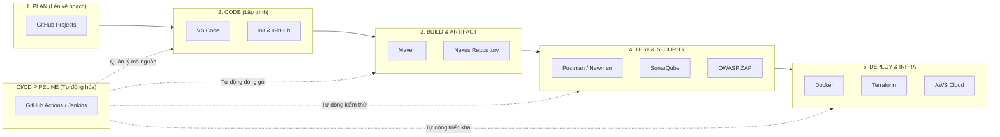

## BƯỚC 4: DevOps Toolchain Map + Tổng kết

### 4.1 Vẽ DevOps Toolchain Map



**Sơ đồ dạng Text (Dành cho bản xem nhanh):**
```text
[1. PLAN]           [2. CODE]          [3. BUILD]          [4. TEST]            [5. DEPLOY & INFRA]
GitHub Projects --> Git + GitHub   --> Maven           --> Postman/Newman   --> Docker (Container)
                    VS Code (IDE)      Nexus (Artifact)    SonarQube (SAST)     Terraform (IaC)
                                                           OWASP ZAP (DAST)     AWS (Cloud)
       ^                  ^                   ^                   ^                     ^
       |__________________|___________________|___________________|_____________________|
                          Điều phối tự động bởi CI/CD: GitHub Actions & Jenkins
```

---

### 4.2 Bảng Công cụ DevOps đã Học

| Giai đoạn | Công cụ | Đã dùng ở lab nào? | Mục đích |
| :--- | :--- | :--- | :--- |
| **Plan** | GitHub Projects | Dự án nhóm | Quản lý task, roadmap |
| **Code** | Git + GitHub | Lab 1, 5 | Quản lý mã nguồn |
| **Code** | VS Code | Lab 2 | IDE soạn thảo code và tích hợp Terminal/Docker |
| **Build** | Maven | Lab 7 | Build Java project |
| **Test** | Postman/Newman | Lab 6 | Kiểm thử API tự động |
| **Test** | SonarQube | Lab 6, 7 | Phân tích mã nguồn tĩnh (Static Code Analysis) |
| **Test** | OWASP ZAP | Lab 6 | Kiểm thử bảo mật (Security Testing) |
| **Deploy** | Docker | Lab 2, 7, 8 | Container hóa ứng dụng |
| **Deploy** | Terraform | Lab 3 | Infrastructure as Code (IaC) |
| **Deploy** | AWS | Lab 3 | Cloud infrastructure |
| **CI/CD** | GitHub Actions | Lab 1 | Tự động deploy web |
| **CI/CD** | Jenkins | Lab 7 | Xây dựng CI/CD pipeline |
| **Artifact** | Nexus | Lab 7 | Quản lý và lưu trữ artifact |

---

### 4.3 Tổng kết — CALMS trong Thực tế

| Nguyên tắc | Bạn đã làm gì? | Lab nào? |
| :--- | :--- | :--- |
| **Culture** | Team workflow với Git Flow + Code Review | Lab 5 |
| **Automation** | CI/CD pipeline tự động deploy website | Lab 1 |
| **Automation** | Viết script tự động hóa `setup-dev-env.sh` (tự động cài đặt môi trường trong 2 phút), `devops-check.sh` và đóng gói ứng dụng `server.js` bằng `Dockerfile` | Lab 2 |
| **Lean** | Docker — chuẩn hóa môi trường nhất quán ở mọi nơi, tránh lỗi lệch môi trường | Lab 2 |
| **Lean** | Infrastructure as Code — không cấu hình hạ tầng thủ công | Lab 3 |
| **Measurement** | Test reports (Newman, SonarQube metrics) đo lường chất lượng | Lab 6 |
| **Measurement** | Theo dõi Pipeline duration, success rate | Lab 7 |
| **Sharing** | Code Review trên GitHub | Lab 5 |
| **Sharing** | Xây dựng Toolchain map & tài liệu hướng dẫn (README/Troubleshooting) — chia sẻ kiến thức | Lab 2 |

---

## BƯỚC 5: CALMS Self-Assessment

### 5.1 Tự Đánh giá DevOps Maturity

| Nguyên tắc | 1 (Yếu) | 3 (Trung bình) | 5 (Xuất sắc) | Điểm của bạn |
| :--- | :--- | :--- | :--- | :---: |
| **Culture** | Dev vs Ops đổ lỗi cho nhau | Dev với Ops ngồi chung team | Mọi người cùng chịu trách nhiệm production | **4/5** |
| **Automation** | Deploy thủ công 100% | Có CI/CD cho 1 số project | Toàn bộ pipeline tự động | **4/5** |
| **Lean** | Setup môi trường mất > 1 ngày | Có script, Docker 1 phần | 1 lệnh → môi trường sẵn sàng | **4/5** |
| **Measurement** | Không biết app có đang chạy không | Có monitoring cơ bản | Dashboard real-time + alert | **3/5** |
| **Sharing** | Mỗi người tự biết, không document | Có wiki nội bộ | Code review + post-mortem + knowledge sharing | **4/5** |
| **TỔNG** | | | | **19/25** |

---

### 5.2 Kế hoạch Cải thiện
Dựa trên điểm số tự đánh giá, 5 hành động cụ thể để cải thiện DevOps maturity:

1. **Cải thiện Measurement (Từ 3 lên 5):** Tích hợp công cụ giám sát hệ thống theo thời gian thực (như Prometheus + Grafana) và thiết lập cảnh báo tự động (Alerting) khi container hoặc server gặp sự cố.
2. **Cải thiện Automation (DevSecOps):** Đưa các công cụ kiểm thử tự động (Newman) và quét bảo mật (SonarQube, OWASP ZAP) vào chạy tự động hoàn toàn bên trong GitHub Actions / Jenkins mỗi khi có code mới.
3. **Cải thiện Lean:** Tối ưu hóa `Dockerfile` bằng kỹ thuật Multi-stage build để giảm dung lượng image và sử dụng `docker-compose` / `Terraform` để khởi tạo toàn bộ môi trường chỉ bằng 1 câu lệnh duy nhất.
4. **Cải thiện Culture:** Duy trì quy trình làm việc nhóm qua Git Flow, kiểm tra chéo (Pull Request Review) và áp dụng văn hóa "Blameless Post-mortem" (cùng tìm nguyên nhân và giải pháp thay vì đổ lỗi khi xảy ra lỗi).
5. **Cải thiện Sharing:** Luôn cập nhật đầy đủ tài liệu `README.md`, sơ đồ kiến trúc Toolchain và bảng hướng dẫn xử lý lỗi (Troubleshooting) trên GitHub để mọi thành viên đều dễ dàng tra cứu và cài đặt.
